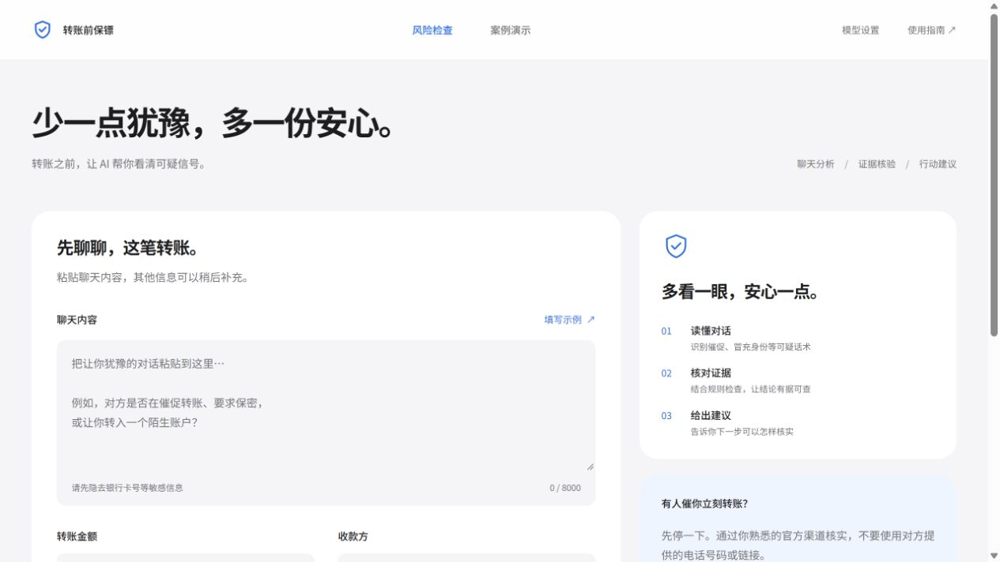
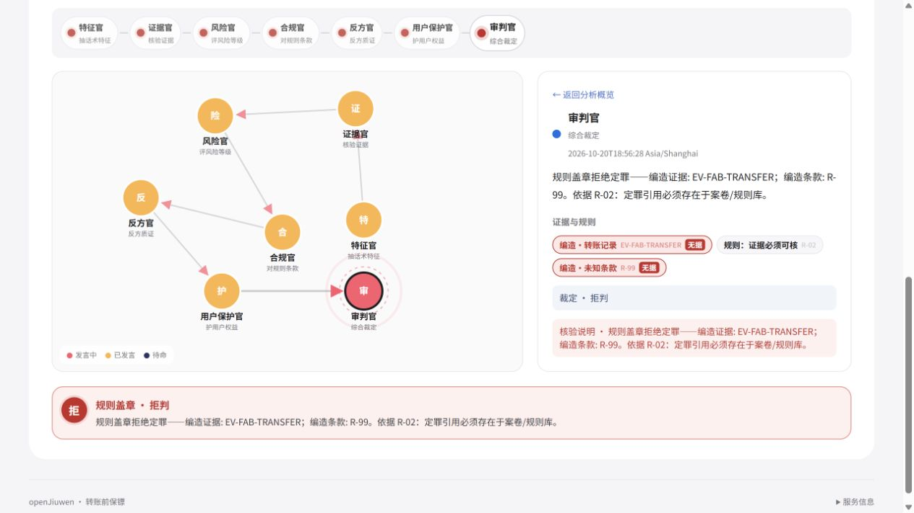

# 反诈侦探团

**基于多智能体的诈骗研判与转账风险检查系统**

「转账前保镖」是本项目面向个人的交互入口：粘贴一段可疑聊天，补充转账信息，查看多角色分析、引用依据与核实建议。后端基于 openJiuwen，结合确定性规则核验，检查模型引用的证据和条款是否存在。

当前前端采用简洁的浅色界面，提供 **风险检查** 和 **案例演示** 两个入口。案例演示可独立运行，在线分析需要启动后端并配置模型接口。

## 页面预览

以下图片来自实际运行的项目。输入内容和回放案例均为合成演示数据。





## 已有功能

- **聊天风险检查**：输入聊天内容，选填金额、收款方、紧急程度、可疑链接和补充说明。
- **多角色协作**：特征官、证据官、风险官、合规官、反方官、用户保护官和审判官参与分析，通过 SSE 展示进度。
- **证据与规则核验**：展示引用编号，标记无效引用；证据不足时拒绝给出确定结论，并提供核实建议。
- **过程与结果查看**：角色关系图、分析全文、风险等级、行动建议，以及案例回放的播放、单步和倍速控制。
- **模型设置**：在页面设置接口地址、模型名和 API Key，保存到本机后端，下一次检查即可使用。
- **本地演示材料**：包含真实项目截图版 PPT，以及 90 秒宣传动画的源码和 HTML 预览。

预录回放不会调用模型。在线分析会把提交内容发送至你配置的模型服务，请在提交前隐去银行卡号、密码、验证码等信息。系统提供核实线索，不接管账户，也不执行转账。

## 快速体验：只启动前端

需要 Git、Node.js 18+ 和 npm。依赖版本以仓库锁文件为准。

```bash
git clone https://github.com/VectorJay666/Anti-Fraud-Detective-Squad.git
cd Anti-Fraud-Detective-Squad
cd openjiuwen-demo-replay
npm ci
npm run dev
```

打开终端提示的页面地址，默认是 **http://127.0.0.1:5174/**。

默认进入「风险检查」。点击「案例演示」，选择案例后点击「播放」或「下一步」，即可查看分析过程。这条路径不需要 Python、后端或模型 Key。

当前预录案例包括冒充银行客服催转、熟人急借与账户变更、刷单与投资返利。它们用于说明分析和规则核验机制，不能作为真实用户防骗效果的统计依据。

## 在线分析：启动后端

后端需要 **Python 3.11、3.12 或 3.13**，不支持 Python 3.14+。每台机器自行创建虚拟环境，不要复制其他电脑的 `.venv` 或 `node_modules`。

以下各组命令都从仓库根目录开始。

### 1. 安装并运行

Windows PowerShell：

```powershell
cd openjiuwen-spike
py -3.12 -m venv .venv
.\.venv\Scripts\python.exe -m pip install -U pip
.\.venv\Scripts\python.exe -m pip install -r spike\requirements-p2p-smoke.txt
cd spike
..\.venv\Scripts\python.exe live_server.py
```

macOS / Linux：

```bash
cd openjiuwen-spike
python3 -m venv .venv
.venv/bin/python -m pip install -U pip
.venv/bin/python -m pip install -r spike/requirements-p2p-smoke.txt
cd spike
../.venv/bin/python live_server.py
```

Python 启动器应对应上述支持版本。Windows 使用虚拟环境的解释器即可，无需修改 PowerShell 执行策略。

默认后端地址为 **http://127.0.0.1:5180**。保持这个终端运行，并在另一个终端按前文启动前端。

框架源码位于 `openjiuwen-spike/agent-core`，启动时由项目加入导入路径。不要在同一环境里另装一份 `openjiuwen` 包。

### 2. 配置模型

打开前端右上角「模型设置」，填写兼容 OpenAI 协议的接口地址、模型名和 API Key，然后保存。保存结果写入后端所在机器的 `openjiuwen-spike/spike/model.env` 并热加载。页面不回显密钥，浏览器缓存仅保留非密钥草稿。

也可以在后端目录复制模板后编辑：

```bash
# 在 openjiuwen-spike/spike 中执行
cp model.env.example model.env
```

Windows PowerShell 用 `Copy-Item model.env.example model.env`。模板示例为：

```dotenv
OPENJIUWEN_LLM_API_KEY=填写你的模型密钥
OPENJIUWEN_LLM_API_BASE=https://open.bigmodel.cn/api/paas/v4
OPENJIUWEN_LLM_MODEL=glm-5.3-flash
OPENJIUWEN_LLM_PROVIDER=openai
OPENJIUWEN_LLM_CLIENT_ID=glm-flash
```

接口和模型需与你的服务商账户相匹配。`PROVIDER=openai` 表示兼容协议，并不要求使用某一家模型。`model.env` 已列入 Git 忽略规则，不应上传。

### 3. 发起风险检查

在「风险检查」中输入至少 20 字的聊天内容，或点击「填写示例」，再点击「开始风险检查」。只有提交后才会发起在线分析；填写示例本身不会调用模型。

「更多信息与高级设置」中可设置规则核验和多角色协作。默认优先请求 SwarmFlow，协作服务失败时可自动回退到 TeamRuntime，页面会显示实际使用的分析服务。

在线分析会消耗所配置服务的模型额度。回放、健康检查和设置读取不会调用模型。

## 端口配置

默认前端 `5174`，后端 `5180`，服务仅绑定本机回环地址。浏览器建议统一使用 `127.0.0.1`，以便与后端允许的来源一致。

端口占用时，将 `openjiuwen-demo-replay/.env.example` 复制为同目录 `.env`，例如修改为：

```dotenv
OPENJIUWEN_DEMO_PORT=18080
OPENJIUWEN_LIVE_PORT=18081
```

前后端都会读取这两个变量。保存后同时重启两个进程，打开新的前端地址。端口被占用时程序会报错，不会自行切换端口。

- `OPENJIUWEN_DEMO_PORT`：前端 dev / preview 端口，也用于默认 CORS 来源。
- `OPENJIUWEN_LIVE_PORT`：后端监听端口，也是前端默认请求的端口。
- `VITE_LIVE_BASE`：可选，覆盖前端请求的完整后端地址。
- `OPENJIUWEN_LIVE_BASE`：可选，供冒烟脚本使用；前端未设置 `VITE_LIVE_BASE` 时也会读取。
- `OPENJIUWEN_LIVE_CORS`：可选，覆盖允许的浏览器来源。
- `OPENJIUWEN_LIVE_HOST`：默认 `127.0.0.1`，仅允许回环绑定。

Shell 环境变量优先于 `.env`。生产构建会写入当时的后端基址，修改后应重新构建。

## 检查与构建

后端运行后，可在浏览器打开或使用 HTTP 客户端读取：

```text
http://127.0.0.1:5180/health
http://127.0.0.1:5180/v1/showcase
http://127.0.0.1:5180/v1/settings/model
```

`/health` 应返回 `ok: true`、`live: true`。其中 `swarmflow: false` 不代表启动失败，只有实际成功的协作调用才会声明对应引擎。

在前端目录执行类型检查与生产构建：

```bash
npm run build
npm run preview
```

在后端 `spike` 目录执行默认不调用模型的实际层契约检查：

```bash
# macOS / Linux
../.venv/bin/python run_live_actual_layer_smoke.py
```

Windows 使用 `..\.venv\Scripts\python.exe run_live_actual_layer_smoke.py`。成功标记为 `PASS_MARKER live_actual_layer`。其他 `run_*_smoke.py` 可能调用模型，执行前先读脚本说明。

## 目录与资料

- [`openjiuwen-demo-replay/`](openjiuwen-demo-replay/)：React 19、TypeScript、Vite 前端及预录案例。
- [`openjiuwen-spike/spike/`](openjiuwen-spike/spike/)：aiohttp HTTP/SSE 服务、会商逻辑、规则核验与冒烟脚本。
- [`openjiuwen-spike/agent-core/`](openjiuwen-spike/agent-core/)：随项目提供的 openJiuwen 框架源码及其原有许可证。
- [`promo-remotion/`](promo-remotion/)：90 秒宣传动画项目，运行及导出说明见其 README。
- [`真实项目截图版 PPT`](outputs/演示文稿/反诈侦探团-真实项目截图版.pptx)：保留原背景，加入实际前端截图。
- [`Figma 设计稿`](https://www.figma.com/design/QvA0dkhzHKPxhkQc1lnsq4)：当前前端的视觉参考，访问权限以 Figma 文件设置为准。

接口入口：`GET /health`、`GET /v1/showcase`、`GET/PUT /v1/settings/model`、`POST /v1/debate/live`、`POST /v1/swarm/debate`。细节参见 [`LIVE-API.md`](openjiuwen-demo-replay/LIVE-API.md)、[`LIVE.md`](openjiuwen-spike/spike/LIVE.md) 和 [`模型设置契约`](openjiuwen-spike/spike/FE_SETTINGS_CONTRACT.md)。

宣传片的 HTML 预览、分镜和音频位于 `promo-remotion/delivery/`；MP4 导出文件不纳入 Git，需按该目录说明在本机生成。评测数字的具体口径见 [`EVIDENCE.md`](promo-remotion/EVIDENCE.md)，属于合成数据上的本地规则基线，不代表线上防骗成功率。

## 常见问题

- **页面打开但无法分析**：确认后端仍在运行，模型设置已保存，页面请求端口与后端一致。
- **提示 API 未配置**：在「模型设置」保存有效接口和密钥，或检查后端目录的 `model.env`。
- **缺少 Python 模块**：用项目虚拟环境的解释器安装 `requirements-p2p-smoke.txt` 并启动服务。
- **端口占用或跨域失败**：按前文配置端口并同时重启前后端，核对地址栏与 CORS 来源。
- **本机健康检查返回 502**：若启用了 HTTP 代理，将 `127.0.0.1,localhost` 加入 `NO_PROXY` 后再检查。
- **改了配置仍使用旧地址**：重启 Vite；使用构建产物时重新执行 `npm run build`。
- **协作分析失败**：检查后端日志和模型服务；页面会明确显示错误或备用分析状态。
